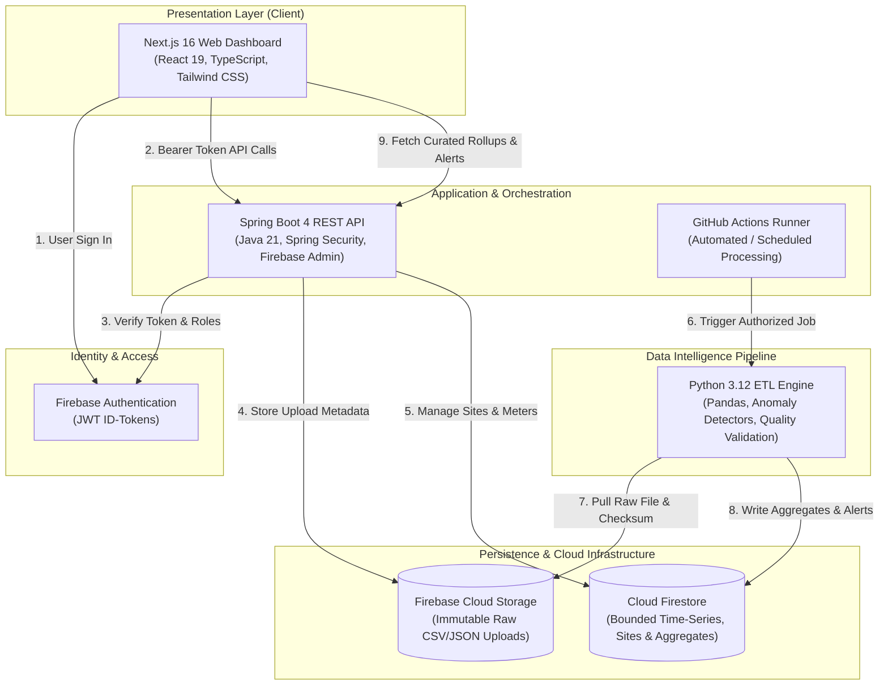

<div align="center">

# 💧 AquaTrace

### Smart Water Usage Analytics & Intelligent Leak Detection Platform

*Empowering property managers, building teams, and sustainability leaders to monitor water consumption, reconcile multi-tenant meter networks, and investigate anomalies before costly damage occurs.*

---

[](https://github.com/bit-coder91/aquatrace-ai)
[](https://nextjs.org/)
[](https://openjdk.org/)
[](https://spring.io/projects/spring-boot)
[](https://www.python.org/)
[](https://firebase.google.com/)
[](https://www.docker.com/)
[](LICENSE)

[Architecture](#-system-architecture) • [Key Features](#-key-features) • [Quick Start](#-quick-start) • [Tech Stack](#-technology-stack) • [Data Pipeline](#-data-pipeline--anomaly-engine) • [API Specs](#-api-endpoints) • [Docs](#-documentation)

---

</div>

## 📌 Executive Overview

**AquaTrace** is an end-to-end telemetry and analytics platform purpose-built for residential complexes, commercial towers, and multi-tenant developments. It transforms raw, fragmented meter readings into high-fidelity water intelligence.

Hidden water leaks, malfunctioning valves, and unmetered consumption account for up to **30% of building water waste**. AquaTrace provides facility teams with the forensic data needed to spot anomalies early, reconcile bulk utility bills with individual sub-meters, and maintain a verifiable audit trail.

> **⚠️ Software Signal Transparency Notice:**
> AquaTrace flags statistical and rules-based anomalies as **investigation signals**. Software does not confirm physical leaks autonomously—it equips maintenance personnel with targeted data points (meter IDs, baselines, timestamps, and severity levels) to inspect physical fixtures efficiently.

---

## ✨ Key Features

<table>
  <tr>
    <td width="50%">
      <h3>🏢 Multi-Tenant Meter Hierarchy</h3>
      <p>Configure complex building topologies including <b>Main Bulk Meters</b> and granular <b>Sub-meters</b>. Automatically computes consumption deltas and flags reconciliation leakage.</p>
    </td>
    <td width="50%">
      <h3>📊 High-Resolution Consumption Trends</h3>
      <p>Aggregates raw interval and cumulative readings into daily site-level totals. Beautiful interactive charts built with <b>Recharts</b> uncover usage peaks and historical anomalies.</p>
    </td>
  </tr>
  <tr>
    <td width="50%">
      <h3>🚨 Rules-Based Anomaly Detection</h3>
      <p>Configurable rules detect <b>sustained low-period (overnight) flow</b>, <b>sudden high-usage bursts</b>, and <b>stale/offline meters</b> with clear contextual recommendations.</p>
    </td>
    <td width="50%">
      <h3>🛡️ Enterprise Zero-Trust Security</h3>
      <p>Stateless <b>Firebase ID-Token</b> verification via Spring Security. Site-scoped role-based access control (<code>PROPERTY_MANAGER</code>, <code>ANALYST</code>, <code>VIEWER</code>) with deny-by-default rules.</p>
    </td>
  </tr>
  <tr>
    <td width="50%">
      <h3>🔄 Idempotent Batch Ingestion</h3>
      <p>Secure CSV/JSON upload pipelines with <b>SHA-256 checksum verification</b>. Deterministic Firestore document keys guarantee safe re-runs without duplicate or corrupted records.</p>
    </td>
    <td width="50%">
      <h3>🐳 Zero-Config Local Emulation</h3>
      <p>Fully containerized with <b>Docker Compose</b> and the <b>Firebase Emulator Suite</b> (Auth, Firestore, Storage, and UI) for offline development without cloud costs.</p>
    </td>
  </tr>
</table>

---

## 🏛️ System Architecture

AquaTrace employs a modern decoupled architecture separating client presentation, secure transactional management, batch processing, and serverless persistence:



---

## 💻 Technology Stack

| Layer | Technologies | Purpose |
| :--- | :--- | :--- |
| **Frontend UI** | Next.js 16 (App Router), React 19, TypeScript, Tailwind CSS v4, Lucide Icons, Recharts | High-performance dashboard, responsive intake forms, interactive telemetry charts |
| **Backend API** | Java 21, Spring Boot 4, Spring Security, Firebase Admin SDK, Maven | Site membership RBAC, meter inventory management, ingestion job coordination |
| **Data Pipeline** | Python 3.12, Pandas 2.2+, NumPy, Pytest | Telemetry normalization, deduplication, interval derivation, rules-based alert evaluation |
| **Cloud Persistence** | Cloud Firestore, Firebase Cloud Storage, Firebase Auth | Operational store, time-series daily aggregates, immutable raw telemetry files |
| **DevOps & Tooling** | Docker, Docker Compose, Firebase Local Emulator Suite, GitHub Actions | Isolated local environment, continuous integration, containerized verification |

---

## 📂 Repository Monorepo Layout

```text
aquatrace/
├── frontend/                   # Next.js 16 App Router interface & Tailwind styles
│   ├── src/app/                # App router pages, layouts, and global styles
│   ├── src/components/         # Reusable UI primitives (Button, forms, metrics)
│   └── src/lib/                # Firebase Client SDK & typed API client
├── backend/                    # Java 21 & Spring Boot 4 REST service
│   ├── src/main/java/          # Domain services (Sites, Meters, Ingestion, Alerts)
│   ├── src/main/resources/     # Application configuration (YAML)
│   └── Dockerfile.vercel       # Production-ready Fluid compute container
├── data-pipeline/              # Python 3.12 batch ETL engine
│   ├── src/aquatrace_pipeline/ # Pipeline core, firestore sink, anomaly rules
│   ├── tests/                  # Pytest unit & regression test suite
│   └── sample-data/            # Synthetic readings (demo_readings.csv)
├── scripts/                    # Emulator bootstrap & synthetic data generators
│   └── firebase-emulator/      # Firebase Emulator container definition
├── docs/                       # Architecture, data model & dev guides
│   ├── architecture.md         # Deep-dive system design & deployment plans
│   ├── firestore-data-model.md # Schema reference & compound index strategy
│   └── local-development.md    # Local environment setup instructions
├── .github/workflows/          # CI testing & data pipeline dispatch workflows
├── docker-compose.yml          # Single-command local orchestration stack
└── firebase.json               # Firestore, Storage, and Auth emulator rules
```

---

## 🚀 Quick Start

Get a complete local development environment running in under 2 minutes with zero external dependencies.

### Prerequisites
- [Docker Desktop](https://www.docker.com/products/docker-desktop/) (with Docker Compose)
- [Git](https://git-scm.com/)

### 1. Clone & Launch Stack

```bash
# Clone the repository
git clone https://github.com/bit-coder91/aquatrace-ai.git
cd aquatrace-ai

# Launch full stack (Next.js + Spring API + Firebase Emulators)
docker compose up --build
```

### 2. Access Local Services

| Service | Local URL | Description |
| :--- | :--- | :--- |
| **Web Dashboard** | [http://localhost:3000](http://localhost:3000) | Next.js frontend application |
| **Spring Boot API** | [http://localhost:8081](http://localhost:8081) | Core REST API service |
| **Firebase Emulator UI** | [http://localhost:4000](http://localhost:4000) | Emulator dashboard for Auth, Firestore & Storage |
| **Firestore Emulator** | `localhost:8080` | Real-time NoSQL database port |
| **Auth Emulator** | `localhost:9099` | Local authentication port |
| **Storage Emulator** | `localhost:9199` | Local object storage port |

---

## 🛠️ Manual Development Setup

If you prefer running services directly on your host machine without Docker:

<details>
<summary><b>1. Backend (Spring Boot 4 & Java 21)</b></summary>

```bash
cd backend
# Run test suite
mvn test

# Run API locally on port 8081
mvn spring-boot:run
```
</details>

<details>
<summary><b>2. Data Pipeline (Python 3.12 & Pandas)</b></summary>

```bash
cd data-pipeline
# Create and activate virtual environment
python -m venv .venv
source .venv/bin/activate  # On Windows: .venv\Scripts\activate

# Install dependencies & run test suite
pip install -r requirements.txt
pytest tests/ -v
```
</details>

<details>
<summary><b>3. Frontend (Next.js 16 & pnpm)</b></summary>

```bash
cd frontend
# Install dependencies
pnpm install

# Start Next.js development server
pnpm dev
```
</details>

---

## 🔄 Data Pipeline & Anomaly Engine

```
[Raw Readings File] ➔ [Validation] ➔ [Normalization] ➔ [Transformation] ➔ [Aggregation] ➔ [Anomaly Rules]
```

1. **Ingest & Checksum:** Validates CSV/JSON structure, validates column headers, computes SHA-256 hash, and archives raw file into Firebase Storage.
2. **Deduplicate & Clean:** Resolves event IDs, sanitizes timestamps into localized site timezones, and isolates unparseable records into quarantine.
3. **Interval Conversion:** Converts cumulative meter indices into distinct interval deltas. Employs counter-reset guards so meter rollover does not produce false spikes.
4. **Site Aggregations:** Calculates site-wide daily water usage, sums sub-meter totals, and isolates the **reconciliation gap** against the main bulk meter.
5. **Anomaly Diagnostics:**
   - **Sustained Low-Period Flow:** Flags continuous consumption during configurable low-demand windows (e.g., 01:00 AM – 05:00 AM).
   - **High-Usage Burst:** Flags flows exceeding the calibrated hourly threshold for a specific unit.
   - **Stale Meter Alert:** Identifies meters that have ceased reporting within expected transmission intervals.

---

## 📡 API Endpoints

All endpoints (except health probes) require a Firebase Bearer token: `Authorization: Bearer <ID_TOKEN>`.

### Sites & Permissions
- `GET /api/v1/sites` — List sites accessible to authenticated user
- `POST /api/v1/sites` — Register a new property/site
- `POST /api/v1/sites/{siteId}/members` — Grant site role to team members

### Meter Inventory
- `GET /api/v1/sites/{siteId}/meters` — Retrieve meter topology and thresholds
- `POST /api/v1/sites/{siteId}/meters` — Register a main meter or submeter
- `PUT /api/v1/sites/{siteId}/meters/{meterId}/thresholds` — Update anomaly detection thresholds

### Ingestion & Raw Files
- `POST /api/v1/sites/{siteId}/ingestion-jobs` — Upload CSV/JSON reading files
- `GET /api/v1/sites/{siteId}/ingestion-jobs` — Review ingestion validation status and error logs

### Analytics & Alerts
- `GET /api/v1/sites/{siteId}/daily-aggregates?from=YYYY-MM-DD&to=YYYY-MM-DD` — Time-series consumption trends
- `GET /api/v1/sites/{siteId}/alerts?status=OPEN` — Active rules-based investigation signals
- `PATCH /api/v1/sites/{siteId}/alerts/{alertId}/acknowledge` — Mark signal as investigated

---

## 🚢 Cloud Deployment

AquaTrace is architected for zero-server overhead:

- **Frontend:** Seamlessly deploys to **Vercel** with native Next.js edge performance.
- **Backend:** Deploys as a containerized HTTP service using [`backend/Dockerfile.vercel`](backend/Dockerfile.vercel) on Vercel Fluid Compute or Google Cloud Run.
- **Batch Pipeline:** Dispatched on demand via GitHub Actions [`pipeline.yml`](.github/workflows/pipeline.yml) using authenticated Google Cloud service account secrets.

---

## 📖 Documentation

- 📐 [Architecture & System Design Deep-Dive](docs/architecture.md)
- 🗄️ [Firestore Schema & Index Strategy](docs/firestore-data-model.md)
- 💻 [Local Development Guide](docs/local-development.md)
- ☕ [Spring Boot API Specifications](backend/README.md)
- 🐍 [Python Data Pipeline Documentation](data-pipeline/README.md)

---

## 🤝 Contributing

Contributions make the open-source community a tremendous place to learn, inspire, and create. Any contributions you make are **greatly appreciated**.

1. Fork the Project
2. Create your Feature Branch (`git checkout -b feature/SmartAnomalyModel`)
3. Commit your Changes (`git commit -m 'feat: Add statistical median anomaly detector'`)
4. Push to the Branch (`git push origin feature/SmartAnomalyModel`)
5. Open a Pull Request

---

## 📄 License

Distributed under the Apache 2.0 License. See `LICENSE` for more information.

---

<div align="center">
  <sub>Engineered with precision for sustainable water intelligence. Built with Next.js, Spring Boot, and Python.</sub>
</div>
