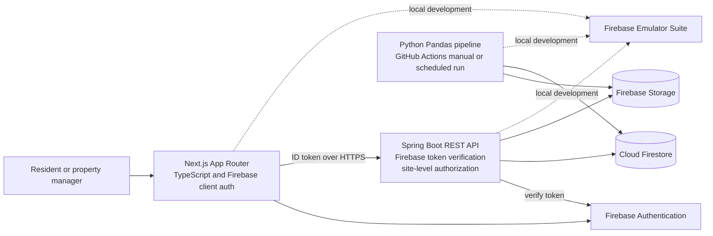

# AquaTrace architecture and implementation plan

## Product specification

AquaTrace helps residents and property managers understand water consumption across buildings, units, and meters. It stores readings, validates incoming data, derives usage summaries, and presents transparent alerts that point to investigation. It distinguishes a recorded reading from a rules-based anomaly and from a suspected leak. Software cannot confirm a physical leak on its own.

The MVP focuses on one complete workflow: authenticate, manage a site and its meters, ingest readings, process them idempotently, and inspect aggregates and alerts.

## MVP versus later enhancements

| MVP | Later enhancements |
| --- | --- |
| Firebase email/password authentication; site membership and role checks | Notification preferences and Firebase Cloud Messaging |
| Site, meter, main meter, and sub-meter management | More report formats and configurable dashboards |
| CSV and simulated reading ingestion with useful validation errors | Additional formats and larger-scale ingestion orchestration |
| Python ETL for normalization, intervals, quality metrics, and daily aggregates | Optional anomaly model evaluated on labeled synthetic data |
| Configurable deterministic rules for high use, sustained low-period flow, and stale meters; main/submeter reconciliation values | Reconciliation alerts and additional rules tuned with operational feedback |
| Daily usage trends, import quality, meter inventory, and investigation alerts | Meter freshness summaries, advanced benchmarking, and richer exports |
| Firebase emulators, local Docker, and essential automated checks | Broader end-to-end and performance evaluation |

## System architecture



The browser authenticates with Firebase and sends its Firebase ID token to the API. Spring verifies the token with the Firebase Admin SDK, then checks membership and role for every protected site resource. The Python pipeline uses server-side credentials and validates the job, source checksum, site, and uploader role before loading. Admin SDK access bypasses Firestore Security Rules, so API and pipeline authorization are mandatory. Client Firestore and Storage rules deny direct access.

Firestore remains the operational and analytics store. Since it is not a relational warehouse and does not support arbitrary joins across a large time series, the pipeline writes curated hourly/daily aggregates for dashboard queries while retaining meter readings for drill-down.

## Vercel deployment design

The intended deployment uses two Vercel projects connected to the monorepo: `frontend/` uses Vercel's Next.js support, and `backend/` builds the Spring Boot HTTP service from `Dockerfile.vercel`. Current official Vercel documentation describes container images deployed as HTTP-serving Vercel Functions on Fluid compute; the container must listen on the runtime `$PORT`. The backend now includes `Dockerfile.vercel` with a runtime-port listener. Recheck the deployment instructions before publishing: [Vercel Docker deployment guide](https://vercel.com/kb/guide/docker), [Vercel container announcement](https://vercel.com/changelog/bring-your-dockerfile-to-vercel-functions).

The API container is stateless and stores durable state only in Firebase. It does not run the Python scheduler or depend on a permanent worker. The frontend receives its API origin through `NEXT_PUBLIC_API_BASE_URL`; CORS allows only configured frontend origins. Vercel secrets and Firebase Admin credentials must be configured as server-side environment variables or supported secret bindings, never copied into source, browser bundles, or container layers.

## Data pipeline and recovery

1. **Ingest:** accept CSV/JSON, compute checksum, save the original in Firebase Storage, and create a stable ingestion job.
2. **Raw metadata:** record source, checksum, upload/processing timestamps, and job state separately from curated readings.
3. **Validate:** check schema, required IDs, timestamps, units, numeric ranges, file size, and row-level validity. Preserve rejection reasons.
4. **Clean:** normalize identifiers, timestamps, and units; identify duplicates; quarantine invalid or ambiguous rows.
5. **Transform:** sort cumulative readings per meter; derive interval usage; explicitly flag resets, missing intervals, and out-of-order events. Never turn a negative counter difference into consumption.
6. **Aggregate:** calculate site-local daily use per meter, use the main meter as the building total when present, and preserve the submeter sum and reconciliation difference. Hourly baselines, peak-period analysis, and coverage scoring remain follow-up work.
7. **Detect:** evaluate configurable deterministic rules and save the baseline, observation, threshold, explanation, and recommended action with each alert.
8. **Load and monitor:** write readings, aggregates, alerts, quality counts, and run/job status. Store bounded summaries and error details, not unbounded arrays or sensitive payloads.

Jobs have explicit states such as `UPLOADED`, `VALIDATING`, `PROCESSING`, `SUCCEEDED`, `PARTIAL`, and `FAILED`. Stable job IDs and deterministic reading/aggregate IDs make retries safe. A retry can overwrite or complete the same logical output rather than create duplicate data. Original files remain available for diagnosis. Rejected records are distinct from infrastructure failures. GitHub Actions secrets hold CI credentials; local credentials stay outside source control. No always-on worker runs inside the Vercel web container.

## Monorepo layout

```text
aquatrace/
├── frontend/                 Next.js App Router, UI, API client
├── backend/                  Spring Boot API, security, Firestore services
├── data-pipeline/            Pandas ingestion and transformations
├── scripts/                  Synthetic data and demo seeding
├── .github/workflows/        CI and manual/scheduled batch pipeline
├── docs/                     Architecture and schema references
├── firebase.json             Emulator configuration
├── firestore.rules           Client database rules
├── firestore.indexes.json    Query indexes
├── storage.rules             Client file access rules
├── docker-compose.yml        Local orchestration
└── README.md                 Setup and demo guide
```

## Original 14-day MVP plan

| Day(s) | Work |
| --- | --- |
| 1 | Approve scope, architecture, data model, and scaffold |
| 2 | Firebase project, emulators, rules, environment template |
| 3–4 | Spring Boot, health endpoint, DTO validation, token verification |
| 5 | Site membership/roles and site/meter APIs |
| 6–7 | Next.js layout, auth flows, protected routes, API client |
| 8 | Synthetic readings and authenticated ingestion |
| 9–10 | Pandas validation, cleaning, interval derivation, retry safety |
| 11 | Daily aggregates and first anomaly rules |
| 12 | Dashboard charts, meter freshness, ingestion and quality summaries |
| 13 | Essential unit/integration checks, emulator and Docker workflows |
| 14 | README, diagrams, demo data, run instructions, scope review |

The estimate assumes a focused MVP and available Firebase credentials. Full reporting, every settings page, production deployment polish, extensive end-to-end coverage, and performance benchmarks may take longer.

## Prerequisites and current machine check

Target Java 21, Python 3.11+, Node.js LTS with npm, Git, Docker Desktop with Compose, Firebase CLI, and a Firebase project. For deployment, also use a Vercel account connected to GitHub.

The setup check on 2026-10-13 found Java 25.0.2, Python 3.13.2, Node 24.19.0, and Git. Maven builds with Java 25 using `--release 21`; bundled Python 3.12 runs the pipeline tests. npm, Docker, Firebase CLI, and Vercel CLI are not available on PATH. Java unit tests and Python pipeline tests pass; frontend build and emulator integration remain unverified.

## Original scaffold commands (PowerShell)

```powershell
java -version
python --version
node --version
npm --version
docker --version
docker compose version
git --version

New-Item -ItemType Directory -Force aquatrace | Out-Null
Set-Location aquatrace
git init

$dirs = @(
  "frontend/src/app",
  "frontend/src/components",
  "frontend/src/lib",
  "frontend/public",
  "backend/src/main/java",
  "backend/src/main/resources",
  "backend/src/test/java",
  "data-pipeline/src/aquatrace_pipeline",
  "data-pipeline/tests",
  "scripts",
  ".github/workflows",
  "docs"
)
New-Item -ItemType Directory -Force $dirs | Out-Null
```

These commands document how the original repository scaffold was created. The current project includes the Spring API, Python pipeline, frontend source, emulator configuration, containers, and CI workflows described above.


